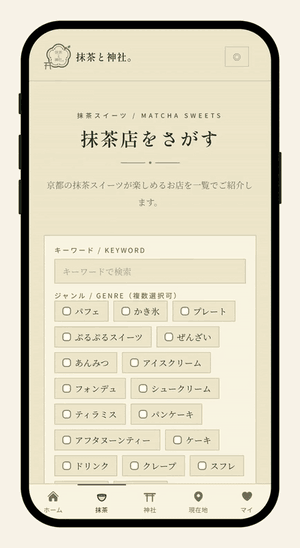
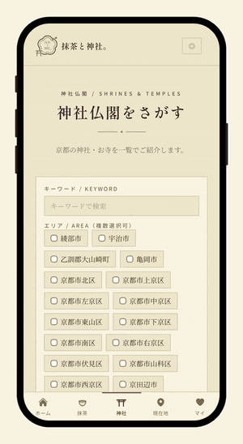
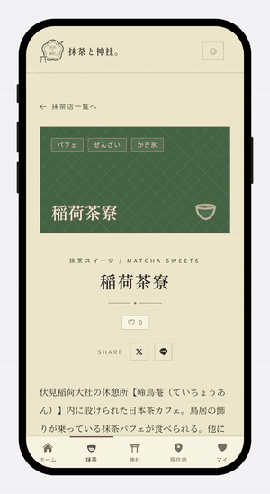
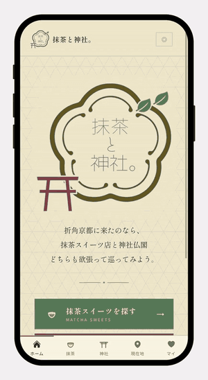
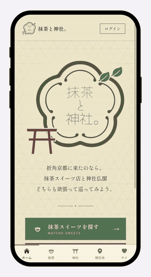
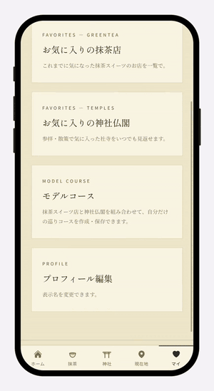
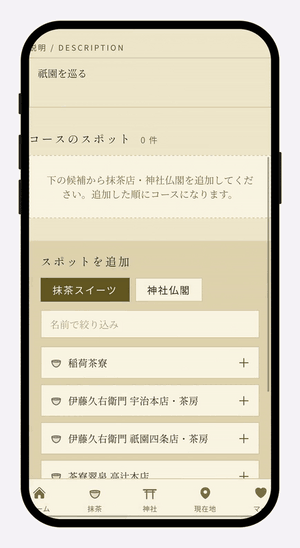
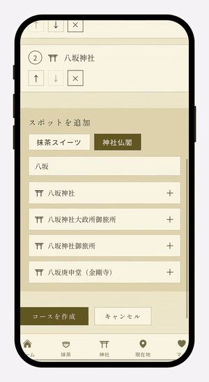
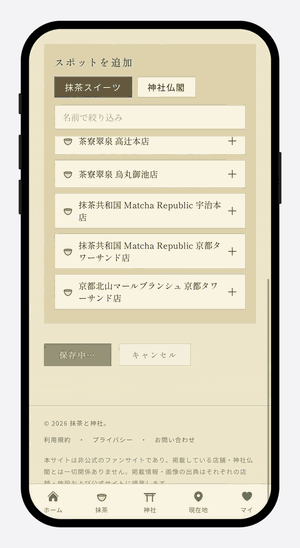
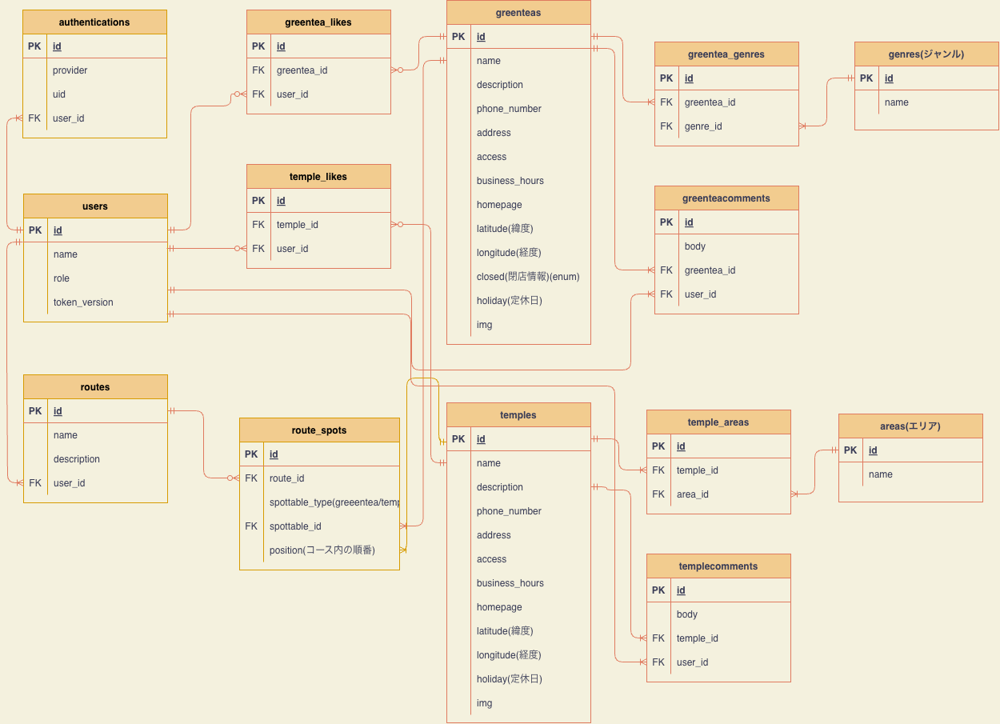

 

# 抹茶と神社。

## サービスURL
https://matcha-to-jinja.vercel.app/

# ■サービス概要
　京都にある抹茶スイーツのお店の近くにある神社仏閣を調べたり、  
　京都にある神社仏閣近くの抹茶スイーツを調べたりすることができ、  
　現在地近くにある抹茶スイーツ店と神社仏閣を調べることができ、  
　また自分だけの抹茶スイーツと神社仏閣のモデルルートが作成出来るサービスです。  

ユーザーが抱える課題

　折角京都に観光に来るなら、   
　京都で有名な抹茶スイーツを食べ、神社仏閣を同時に巡りたいと考えるユーザーは多いと考えられる。   
　しかし抹茶スイーツをまとめたサイトや、神社仏閣をまとめたサイトはあっても、   
　それら二つを同時に見られるサイトはあまりない。   
　その為それら二つを同時に探すことができ、   
　尚且つ行きたい箇所の距離や行き方を調べたりすることができるようにしたい。   

解決方法

　・興味のあるスイーツのジャンルから抹茶スイーツを探すことができる   
　・行く予定のある地域の神社仏閣を調べることができる   
　・行きたい抹茶スイーツ店近くの神社仏閣、行きたい神社仏閣近くの抹茶スイーツ店を知ることができる   
　・現在地から行ける抹茶スイーツ店、神社仏閣を調べることができる      
　・行きたい抹茶スイーツ店・神社仏閣を並べて、自分だけのモデルコースを作ることができる   

　

# ■機能に関して  

> 現在の画面は Next.js フロントエンド（[matcha-to-jinja](https://github.com/hiiragi17/matcha-to-jinja)）が担っており、
> 本リポジトリはその API バックエンドとして機能を提供しています。

## 1. 抹茶スイーツと神社仏閣が検索できる
抹茶スイーツはキーワードとスイーツのカテゴリで、 
神社仏閣はキーワードと地域で検索ができます。 
一覧ページでは施設の名前、カテゴリ(地域)、住所、アクセス、定休日をわかるようにしており、 
気になったら詳細ページに飛べるようになっています。 

| 抹茶スイーツの検索 | 神社仏閣の検索 |
|:---:|:---:|
|  |  |

## 2. 詳細ページでは、それぞれの情報とその近くにある施設を見ることができる 
抹茶スイーツ店・神社仏閣の詳細ページではそれぞれの情報と、 
半径1.5km以内にある抹茶スイーツ店・神社仏閣を見ることができます。 
またX（旧Twitter）やLINEで抹茶スイーツ店・神社仏閣を共有することもできます。 

詳細ページの地図には、その場所とその周りにあるスポットが表示されており、 
スポットのリンクから、それぞれの詳細ページに飛べるようになっています。 

## 3.現在地検索で近くにある抹茶スイーツ店と神社仏閣を調べることができる 
京都にいれば、現在地周りの抹茶スイーツ店と神社仏閣を見ることができます。 
茶碗のアイコンが抹茶スイーツ店、鳥居のアイコンが神社仏閣になっており、 
吹き出しをクリックすると、詳細ページにアクセスすることができます。 

## 4. ユーザーログインするといいね機能が使える 
ユーザー登録することで「いいね機能」が利用可能になります。 
登録＆ログインは、Google・LINEの外部認証から選択できます。 

## 5. ユーザーログインすると口コミ機能が使える 
ユーザー登録することで「口コミ機能」が利用可能になります。 
それぞれの抹茶スイーツ・神社仏閣の詳細ページから口コミ一覧ページに飛べるようになっています。 
※口コミ一覧を見るだけの場合は、ログインは必要ありません。 

## 6. ユーザーログインするとモデルコースを作成できる 
ユーザー登録することで「モデルコース機能」が利用可能になります。 
行きたい抹茶スイーツ店・神社仏閣を選んで並べるだけで、自分だけの巡り方を作れます。 
コースの詳細ページでは、スポットどうしの行き方を Google マップで確認できます（電車・バス・徒歩などの移動手段は Google マップ上で選べます）。 

| マイページ | スポットを追加 | 神社仏閣も追加 | 保存 |
|:---:|:---:|:---:|:---:|
|  |  |  |  |

# ■使用技術  
バックエンド（本リポジトリ）

　・Ruby 3.4.13  
　・Ruby on Rails 8.1.x（`ActionController::API` による `api/v1` 名前空間で JSON API を提供）
　・PostgreSQL  
　・Ransack（検索）/ Kaminari（ページネーション）  
　・Geokit + Geocoder（緯度経度・距離計算）  
　・CarrierWave + MiniMagick（画像アップロード）  
　・jsonapi-serializer（API レスポンス）  
　・JWT 認証（LINE / Google のアクセストークンを各社 API で検証して発行）  
　・rack-cors（CORS）/ rack-attack（レート制限）  

フロントエンド（[matcha-to-jinja](https://github.com/hiiragi17/matcha-to-jinja)）    

　・Next.js（App Router）+ React + TypeScript  
　・Tailwind CSS v4 + daisyUI 5  
　・NextAuth.js（Google / LINE の OAuth 認証）  
　・SWR（データ取得）/ react-hook-form + zod（フォーム）  
　・@vis.gl/react-google-maps（地図）  
　※ Rails 側の旧 Web フロント（HTML 画面・JS/CSS ビルド）は撤去済み

インフラ    

　・GCP Cloud Run（バックエンド API）  
　・Neon PostgreSQL（本番 DB）  
　・Vercel（フロントエンド）  
　・GitHub Actions（CI: RSpec / RuboCop / Trivy、main マージで Cloud Run へ自動デプロイ）  

テスト  

　・バックエンド: RSpec（request spec 中心）+ FactoryBot  
　・フロントエンド: Vitest + Testing Library + MSW / Playwright（E2E）  

使用API 

　・Google Geocoding API（緯度経度の取得に使用）  
　・Google Maps JavaScript API（マップ作成に使用）  

# ■ER図

# ■その他

[【個人開発】京都観光できっと大活躍！🍵京都の抹茶スイーツ店と神社仏閣のどちらも検索できるサービスを作った話。⛩【Rails7】](https://qiita.com/hiiragi_en17/items/721174747da020cd84f5)

[画面遷移図](https://www.figma.com/file/AooAFozghAwS7wKYnJsxmo/%E6%8A%B9%E8%8C%B6%E3%81%A8%E7%A5%9E%E7%A4%BE%E3%80%82%E7%94%BB%E9%9D%A2%E9%81%B7%E7%A7%BB%E5%9B%B3?node-id=0%3A1&t=jNXYQ676FQBXQweI-0)

- 初月PV数・・・5148回

- 初月UU数・・・671人
